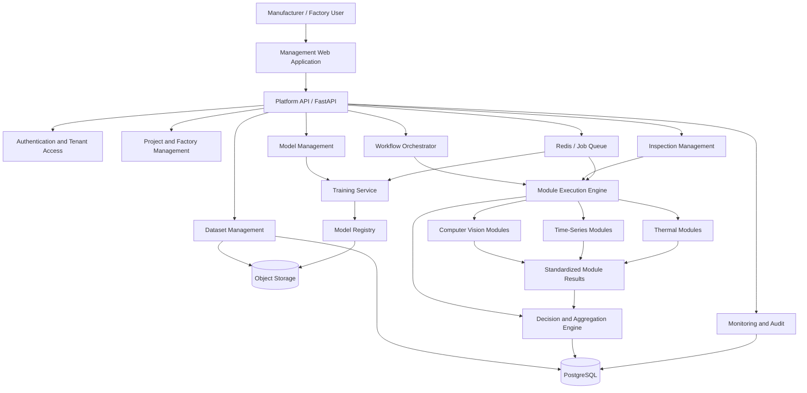
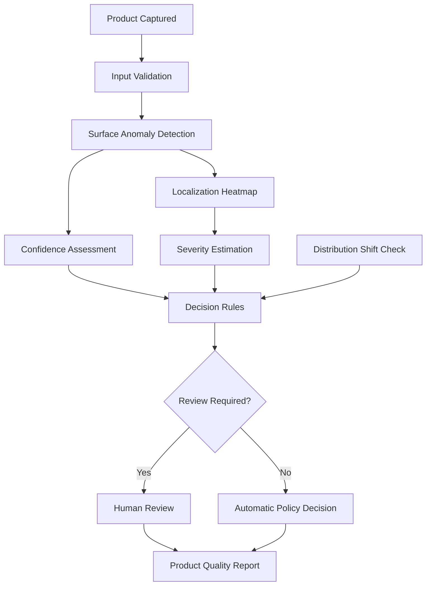
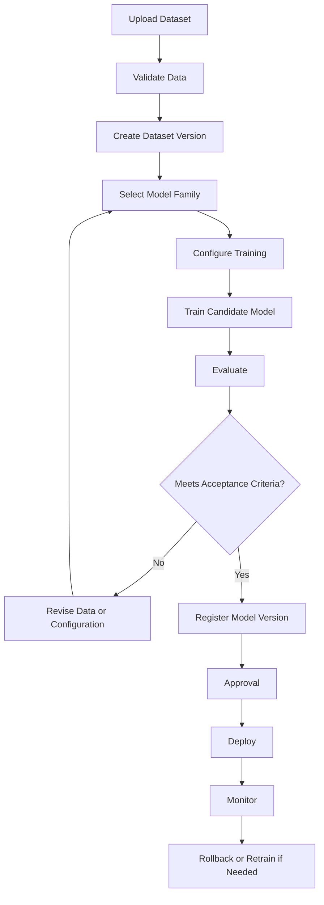
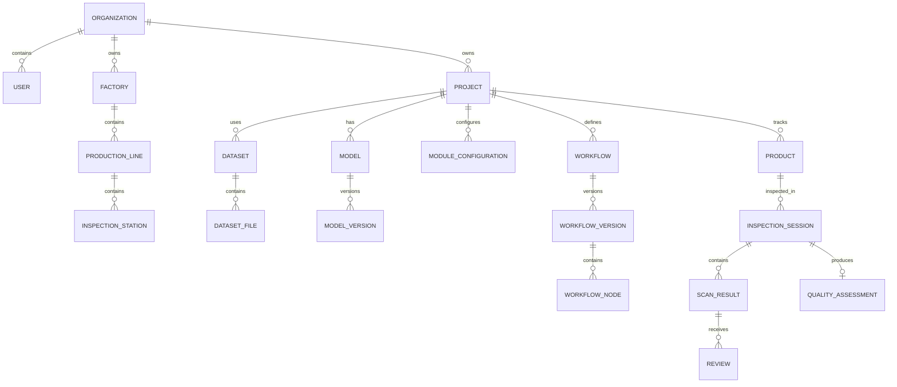

# PROMETHEUS-X

## Modular Industrial AI & Quality Intelligence Platform

> **Teach machines what normal looks like, so they can recognize what
> nobody has taught them to detect.**

**Project category:** Industrial AI / Smart Manufacturing / Advanced
Computer Vision\
**Challenge:** A06 --- PROMETHEUS-X: Detect the Defect That Your Model
Has Never Been Trained to Recognize\
**Project type:** Configurable, multi-industry industrial anomaly
detection and quality-management platform\
**Document status:** Product vision and technical blueprint for
hackathon implementation\
**Version:** 0.1

------------------------------------------------------------------------

## Table of Contents

1.  [Executive Summary](#1-executive-summary)
2.  [Problem Statement](#2-problem-statement)
3.  [Product Vision](#3-product-vision)
4.  [Core Design Principles](#4-core-design-principles)
5.  [Target Users and Use Cases](#5-target-users-and-use-cases)
6.  [Product Scope](#6-product-scope)
7.  [Platform Architecture](#7-platform-architecture)
8.  [AI Module Library](#8-ai-module-library)
9.  [Data Ingestion and Custom Dataset
    Learning](#9-data-ingestion-and-custom-dataset-learning)
10. [Inspection Workflow Builder](#10-inspection-workflow-builder)
11. [Multi-Scan Aggregation and Quality
    Scoring](#11-multi-scan-aggregation-and-quality-scoring)
12. [Inspection Results and User
    Experience](#12-inspection-results-and-user-experience)
13. [Distribution-Shift Detection](#13-distribution-shift-detection)
14. [False-Positive Management and Human
    Review](#14-false-positive-management-and-human-review)
15. [Model Training, Evaluation, and
    Lifecycle](#15-model-training-evaluation-and-lifecycle)
16. [Proposed Technology Stack](#16-proposed-technology-stack)
17. [System Components and
    Responsibilities](#17-system-components-and-responsibilities)
18. [Data Model and Database Design](#18-data-model-and-database-design)
19. [API Design](#19-api-design)
20. [Standard Module Contract](#20-standard-module-contract)
21. [Security, Privacy, and
    Multi-Tenancy](#21-security-privacy-and-multi-tenancy)
22. [Deployment Architecture](#22-deployment-architecture)
23. [Observability and Auditability](#23-observability-and-auditability)
24. [Evaluation Metrics](#24-evaluation-metrics)
25. [Hackathon MVP Scope](#25-hackathon-mvp-scope)
26. [Implementation Roadmap](#26-implementation-roadmap)
27. [Repository Structure](#27-repository-structure)
28. [Risks, Limitations, and
    Mitigations](#28-risks-limitations-and-mitigations)
29. [Future Enhancements](#29-future-enhancements)
30. [Demo Storyline](#30-demo-storyline)
31. [Glossary](#31-glossary)

------------------------------------------------------------------------

# 1. Executive Summary

**PROMETHEUS-X** is a modular industrial AI and quality-intelligence
platform designed to help manufacturers detect defects and abnormal
conditions that may not have appeared in a model's training data.

Rather than building a separate, isolated application for every factory
or manufacturing category, PROMETHEUS-X provides a common management
platform where a manufacturer can:

-   Create organizations, factories, production lines, products, and
    inspection stations.
-   Upload their own production data and define the context in which it
    was collected.
-   Validate, organize, and prepare datasets for model training.
-   Train or configure specialized AI models for a particular product,
    process, or data modality.
-   Run individual AI inspection modules independently.
-   Connect multiple modules into reusable inspection workflows.
-   View anomaly heatmaps, localization masks, bounding boxes, severity
    estimates, confidence and uncertainty information.
-   Detect changes in data or production conditions that may make a
    model less reliable.
-   Route uncertain or suspicious cases to human reviewers.
-   Aggregate multiple scan results into a traceable product-level
    quality assessment.
-   Monitor inspection history, quality trends, model versions, and
    operational alerts.

The platform is **universal at the software and workflow level, not
through one universal model**. Different materials, products, cameras,
sensors, and industrial processes require different data adapters, model
families, training configurations, and validation rules. PROMETHEUS-X
standardizes how those specialized components are managed and connected.

### Product proposition

**Bring your production data. Configure your inspection. Connect your AI
modules. Get one traceable quality assessment.**

### Primary differentiator

The central differentiator is the combination of:

1.  Custom industrial dataset onboarding.
2.  Specialized, replaceable AI modules.
3.  Independent module execution and visual workflow chaining.
4.  Multi-modal and multi-scan orchestration as the platform evolves.
5.  Product-level quality aggregation with explicit uncertainty and
    decision rules.
6.  Centralized industrial quality management and human review.

------------------------------------------------------------------------

# 2. Problem Statement

Traditional automated quality inspection systems often depend on known
defect categories and labeled examples. A supervised classifier may
recognize scratches, dents, cracks, or other defects represented in its
training set, but real manufacturing environments continually produce
new, rare, subtle, or previously unseen defects.

Industrial environments also change:

-   Lighting and camera exposure vary.
-   Cameras may be replaced, moved, or recalibrated.
-   Materials and suppliers change.
-   Product variants and manufacturing processes evolve.
-   Sensors drift or fail.
-   New production lines may have different visual characteristics.
-   Defects may be extremely rare and difficult to label.

A system that only recognizes predefined defect classes may fail to flag
a novel defect. A system that flags every visual difference may generate
too many false positives and interrupt production.

The challenge is therefore not simply to classify a product as defective
or non-defective. A useful industrial system must:

1.  Learn representative patterns of normal production.
2.  Detect anomalies, including unfamiliar anomalies.
3.  Localize suspicious regions.
4.  Estimate severity and communicate uncertainty.
5.  Detect when incoming data differs from the conditions under which
    the model was validated.
6.  Manage false positives and uncertain decisions.
7.  Preserve evidence and traceability for each inspection.

### Refined problem statement

> Build a configurable industrial anomaly-detection and
> quality-intelligence platform that learns normal production patterns
> from manufacturer-provided data, detects and localizes previously
> unseen anomalies, evaluates severity and uncertainty, monitors
> distribution shifts, manages false positives, and combines multiple
> specialized inspection results into a traceable product-level quality
> assessment.

------------------------------------------------------------------------

# 3. Product Vision

PROMETHEUS-X aims to become a configurable operating layer for
industrial AI inspection.

A manufacturer should not need to build a new software platform whenever
they introduce a new product, production line, camera, or inspection
requirement. They should be able to create a project, provide
representative data, select or train appropriate models, configure
inspection modules, and connect those modules into a workflow.

### Two major product components

#### A. Management Application

The management application is the central interface for factory and
quality teams. It manages:

-   Organizations and users.
-   Factories, lines, stations, and products.
-   Datasets and data quality.
-   AI models and model versions.
-   Module configurations.
-   Inspection workflows.
-   Inspection jobs and results.
-   Quality scores and decision policies.
-   Alerts, reviews, and reports.
-   Audit logs and platform settings.

#### B. Modular AI Engine

The AI engine provides reusable capabilities that can be independently
executed or composed into workflows.

Examples include:

-   Image anomaly detection.
-   Pixel-level anomaly localization.
-   Surface-defect segmentation.
-   Dimensional deviation analysis.
-   Sensor time-series anomaly detection.
-   Thermal anomaly detection.
-   Acoustic anomaly detection.
-   Severity estimation.
-   Confidence calibration.
-   Distribution-shift monitoring.
-   False-positive control.
-   Quality-score aggregation.

A module may contain a model, deterministic processing logic, or a
combination of both. Not every module needs to be a separately trained
neural network.

------------------------------------------------------------------------

# 4. Core Design Principles

## 4.1 Universal platform, specialized models

Do not attempt to train one model that understands every industrial
domain. The platform should provide common infrastructure while using
models suited to each data modality and application.

For example:

-   PCB surface inspection may use a visual anomaly model trained on PCB
    imagery.
-   Metal surface inspection may use a different model and preprocessing
    configuration.
-   Machine vibration analysis may use a time-series model.
-   Thermal inspection may use a thermal-image model.

These models can still expose standardized outputs to the platform.

## 4.2 Modular by design

Every capability should have a clear responsibility and a defined
input/output contract. Modules should be independently testable,
versionable, replaceable, and reusable.

## 4.3 Human-supervised decisions

AI output should support industrial decisions, not silently replace
engineering standards or safety procedures. Low-confidence,
high-severity, out-of-distribution, and policy-defined cases should be
routed for review.

## 4.4 Traceability

Every final quality assessment must be traceable to:

-   The product or item inspected.
-   The source data.
-   The inspection workflow version.
-   The module versions.
-   The model versions.
-   The configuration and thresholds.
-   The individual scan results.
-   The aggregation policy.
-   Any human review or override.

## 4.5 Explicit uncertainty

Anomaly score, confidence, severity, and quality score are different
quantities. The platform must not present them as interchangeable.

## 4.6 Incremental extensibility

The architecture should support additional modalities and integrations
without requiring a rewrite of the core management application.

## 4.7 Reproducibility

A result should be reproducible as far as practical by retaining model
versions, preprocessing versions, configuration, and source references.

------------------------------------------------------------------------

# 5. Target Users and Use Cases

## 5.1 Target users

  -----------------------------------------------------------------------
  User                                Primary needs
  ----------------------------------- -----------------------------------
  Quality manager                     Monitor quality, review failures,
                                      compare lines and products

  Manufacturing engineer              Configure inspection requirements
                                      and production rules

  ML engineer                         Prepare data, train models,
                                      evaluate performance, manage
                                      versions

  Factory operator                    View inspection decisions and
                                      handle review queues

  Plant administrator                 Manage factories, stations, users,
                                      and access

  Auditor                             Trace decisions, model versions,
                                      and inspection evidence

  Platform administrator              Manage tenants, deployments,
                                      services, and system health
  -----------------------------------------------------------------------

## 5.2 Initial industry candidates

### Electronics and PCB manufacturing

Potential inspection tasks:

-   Missing or misplaced components.
-   Solder irregularities.
-   Surface contamination.
-   Scratches and board damage.
-   Unexpected component appearance.
-   Differences between board variants.

### Metal fabrication

Potential inspection tasks:

-   Scratches.
-   Dents.
-   Surface corrosion.
-   Coating irregularities.
-   Unexpected texture changes.
-   Geometric deviations.

### Automotive manufacturing

Potential inspection tasks:

-   Paint and coating defects.
-   Panel surface irregularities.
-   Assembly inconsistencies.
-   Dimensional deviations.
-   Component presence and placement.

### Textile manufacturing

Potential inspection tasks:

-   Weaving irregularities.
-   Holes and tears.
-   Stains.
-   Unexpected patterns.
-   Texture inconsistencies.

The first release should focus on one or two image-based inspection
demonstrations. These domains provide a practical way to show that the
same platform can configure different projects without claiming that one
model works across all industries.

------------------------------------------------------------------------

# 6. Product Scope

## 6.1 Core platform capabilities

  -----------------------------------------------------------------------
  Capability              Description             MVP priority
  ----------------------- ----------------------- -----------------------
  Organization and        Separate manufacturer   High
  project management      workspaces and          
                          inspection projects     

  Dataset upload          Upload                  High
                          manufacturer-provided   
                          images and metadata     

  Dataset validation      Detect corrupt files,   High
                          duplicates, poor        
                          quality, and split      
                          leakage                 

  Model training          Train a normal-only     High
                          anomaly-detection       
                          baseline                

  Model evaluation        Evaluate image-level    High
                          and pixel-level         
                          performance             

  Module library          Browse and configure    High
                          available inspection    
                          modules                 

  Workflow builder        Connect modules into an High
                          inspection pipeline     

  Inspection execution    Run images through      High
                          selected modules        

  Heatmap visualization   Show anomaly regions on High
                          the original image      

  Severity and confidence Provide risk and        High
                          uncertainty information 

  Distribution-shift      Detect changes in       High
  monitoring              incoming data           

  False-positive          Thresholding and human  High
  management              review                  

  Multi-scan aggregation  Combine results into a  High
                          product-level           
                          assessment              

  Sensor and audio        Additional data         Later
  support                 modalities              

  Factory equipment       OPC UA, MQTT, PLC,      Later
  integrations            industrial cameras      

  Edge inference          Run inference close to  Later
                          the production line     
  -----------------------------------------------------------------------

## 6.2 Out of scope for the initial hackathon MVP

-   A single model that works on every industry.
-   Fully autonomous rejection of safety-critical products.
-   Complete OPC UA/PLC integration.
-   Full industrial edge-device fleet management.
-   Guaranteed detection of every possible unknown defect.
-   Automatic retraining and deployment without validation or approval.
-   A complete enterprise billing and licensing system.

------------------------------------------------------------------------

# 7. Platform Architecture

## 7.1 High-level architecture



## 7.2 Architectural layers

### Layer 1: Presentation

Responsibilities:

-   Authentication and workspace selection.
-   Project and factory configuration.
-   Dataset upload and review.
-   Model and module configuration.
-   Visual workflow construction.
-   Inspection result visualization.
-   Analytics and reports.
-   Human review interface.

Suggested technologies: React, TypeScript, Tailwind CSS, React Flow.

### Layer 2: Platform API

Responsibilities:

-   Request validation.
-   Authentication and authorization.
-   Tenant isolation.
-   Project and resource management.
-   Dataset and model metadata.
-   Workflow version management.
-   Inspection job creation.
-   Result retrieval.
-   Audit logging.

Suggested technology: FastAPI.

### Layer 3: Data and Model Services

Responsibilities:

-   File validation.
-   Metadata extraction.
-   Preprocessing.
-   Dataset versioning.
-   Training job orchestration.
-   Evaluation.
-   Model artifact storage.
-   Model registry and lifecycle.

### Layer 4: AI Execution Engine

Responsibilities:

-   Load module configurations.
-   Resolve model versions.
-   Execute workflow nodes.
-   Pass standardized inputs and outputs.
-   Handle retries, timeouts, and failures.
-   Persist execution evidence.

### Layer 5: Intelligence and Decision Layer

Responsibilities:

-   Normalize module outputs where appropriate.
-   Estimate severity and uncertainty.
-   Evaluate distribution shift.
-   Apply false-positive policies.
-   Aggregate scan results.
-   Produce product-level quality assessments.

### Layer 6: Infrastructure

Responsibilities:

-   Relational metadata storage.
-   Object and model-artifact storage.
-   Background job queue.
-   Logs and metrics.
-   Deployment and scaling.

------------------------------------------------------------------------

# 8. AI Module Library

Modules are the building blocks of the platform. The module library
should expose each capability with a description, supported input types,
configuration schema, output schema, version, and execution
requirements.

## 8.1 Data Intelligence Module

**Purpose:** Understand and validate incoming data before training or
inference.

Responsibilities:

-   Identify file formats and data modalities.
-   Validate file integrity.
-   Extract image dimensions, channels, timestamps, and metadata.
-   Detect duplicate or near-duplicate images.
-   Identify corrupt or unreadable files.
-   Flag extremely dark, bright, blurry, or low-resolution images.
-   Check class or category balance when labels exist.
-   Detect possible train/validation/test leakage.
-   Verify required metadata.
-   Generate a dataset readiness report.

Example output:

``` json
{
  "module": "data_intelligence",
  "status": "completed",
  "dataset_id": "dataset_001",
  "file_count": 1200,
  "valid_count": 1187,
  "invalid_count": 13,
  "duplicate_count": 21,
  "warnings": [
    "Some images have low resolution",
    "Lighting varies significantly across the dataset"
  ],
  "readiness": "review_recommended"
}
```

A readiness score may be useful as a summary, but it should be
accompanied by the underlying checks and warnings. It must not imply
that the dataset is representative merely because its files are
readable.

## 8.2 Anomaly Detection Module

**Purpose:** Identify samples or regions that differ from learned normal
patterns.

Initial candidate algorithms:

-   PatchCore.
-   PaDiM.
-   EfficientAD.
-   Reverse Distillation.
-   Other models supported by the chosen framework.

For the MVP, PatchCore is a practical baseline because it learns
representations of normal image patches and scores deviations from the
learned normal feature distribution.

Important constraints:

-   Train the initial model using defect-free examples for the intended
    use case.
-   Keep validation and test data separate.
-   Do not accidentally include test defects in the normal training set.
-   Evaluate on defect types withheld from training.
-   Treat the output as an anomaly signal, not an automatically verified
    defect diagnosis.

Example output:

-   Image-level anomaly score.
-   Pixel-level anomaly map, if supported.
-   Model and model-version identifiers.
-   Processing time.
-   Execution status.

## 8.3 Localization Module

**Purpose:** Convert anomaly evidence into an interpretable spatial
result.

Outputs may include:

-   Pixel-level anomaly heatmap.
-   Binary anomaly mask after thresholding.
-   Bounding boxes around connected suspicious regions.
-   Region area and location.
-   Overlay image for visualization.

A heatmap should be generated from the model's spatial anomaly scores.
The visualization should preserve the original image and show the
anomaly map as a separate, inspectable layer.

Do not imply that every heatmap pixel is a ground-truth defect. The
heatmap is model evidence and must be evaluated against pixel-level
annotations where available.

## 8.4 Severity Estimation Module

**Purpose:** Estimate the operational significance of an anomaly.

Possible input signals:

-   Anomaly magnitude.
-   Anomaly area.
-   Number of suspicious regions.
-   Region location.
-   Product-specific critical zones.
-   Engineering thresholds.
-   Historical reviewed outcomes.
-   Inspection type.

Severity categories:

-   Informational.
-   Low.
-   Medium.
-   High.
-   Critical.

Severity is application-specific. A small anomaly near a critical
connection may be more important than a large cosmetic irregularity. The
system should allow factory engineers to define rules and thresholds.

The MVP can use transparent, configurable rules. A learned severity
model should only be introduced when sufficiently reliable severity
labels exist.

## 8.5 Confidence and Uncertainty Module

**Purpose:** Communicate how reliable the system's output is likely to
be.

Possible methods:

-   Calibration on a held-out validation set.
-   Temperature scaling for suitable model outputs.
-   Reliability diagrams.
-   Expected Calibration Error (ECE).
-   Conformal methods where assumptions and data requirements are
    satisfied.
-   Out-of-distribution indicators.

Important distinction:

-   Anomaly score measures deviation from learned normal patterns.
-   Confidence or uncertainty communicates reliability of the model's
    assessment.
-   Severity estimates potential consequence.
-   Quality score aggregates policy-defined inspection evidence.

These values must not be presented as interchangeable probabilities.

## 8.6 Distribution-Shift Detection Module

**Purpose:** Identify when incoming data differs from the data or
conditions used to validate a model.

Potential signals:

-   Image brightness and contrast distributions.
-   Color histograms.
-   Image sharpness and resolution.
-   Feature-embedding distributions.
-   Sensor-value distributions.
-   Missing or changed metadata.
-   Anomaly-score distributions.
-   Camera or station identity changes.

Possible techniques:

-   Population Stability Index (PSI) for suitable tabular distributions.
-   Kolmogorov--Smirnov tests for suitable univariate distributions.
-   Embedding-distance monitoring.
-   Distribution-distance metrics.
-   Change-point detection for time-series data.

Shift detection is not proof that the model is wrong or that a product
is defective. It is a warning that the input conditions may have changed
and model reliability should be reassessed.

Possible outcomes:

-   No significant shift detected.
-   Warning: monitor.
-   Significant shift: review required.
-   Severe shift: pause automated decisions according to policy.

## 8.7 False-Positive Management Module

**Purpose:** Reduce unnecessary alarms and ensure uncertain results are
handled safely.

Capabilities:

-   Configurable thresholds.
-   Per-product or per-station thresholds.
-   Region-specific rules.
-   Human-review queue.
-   Reviewer feedback.
-   Duplicate-alert grouping.
-   Suppression rules with audit history.
-   Threshold tuning based on validation evidence.

Do not simply raise thresholds until false positives disappear. That can
increase false negatives. Threshold changes must be evaluated against
both missed defects and false alarms.

## 8.8 Decision and Aggregation Module

**Purpose:** Combine outputs from multiple modules and inspection stages
into a final assessment.

Responsibilities:

-   Validate that required scan results exist.
-   Check module and model versions.
-   Normalize compatible risk signals.
-   Apply configurable weights and business rules.
-   Apply critical-defect overrides.
-   Handle missing or failed scans.
-   Propagate uncertainty or mark it as incomplete.
-   Produce a traceable final report.

The decision module must not treat arbitrary model scores as directly
comparable without calibration or a documented normalization method.

## 8.9 Future modality-specific modules

  -----------------------------------------------------------------------
  Modality                            Example module family
  ----------------------------------- -----------------------------------
  Image                               CNN/ViT-based anomaly detection and
                                      segmentation

  Thermal image                       Thermal anomaly detection

  Time series                         Statistical, forecasting, and
                                      sequence-model anomaly detection

  Audio                               Spectrogram and acoustic anomaly
                                      detection

  3D / point cloud                    Geometric deviation and point-cloud
                                      analysis

  Tabular process data                Statistical and machine-learning
                                      anomaly detection
  -----------------------------------------------------------------------

Each modality requires its own data adapter, preprocessing, model
family, validation strategy, and domain-specific interpretation.

------------------------------------------------------------------------

# 9. Data Ingestion and Custom Dataset Learning

## 9.1 Manufacturer-controlled data onboarding

The platform should let a manufacturer create an inspection project and
provide data relevant to that project.

A typical onboarding flow:

1.  Create organization or select an existing workspace.
2.  Create a factory and production line.
3.  Create a product or inspection target.
4.  Choose the inspection modality.
5.  Upload representative data.
6.  Provide optional labels and metadata.
7.  Run data validation.
8.  Review the dataset readiness report.
9.  Configure a training and validation strategy.
10. Train or select a model.
11. Evaluate the model.
12. Approve a model version for deployment.

## 9.2 Image dataset organization

A simple initial folder convention:

``` text
dataset/
├── train/
│   └── normal/
│       ├── image_001.png
│       ├── image_002.png
│       └── ...
├── validation/
│   ├── normal/
│   └── defect/
└── test/
    ├── normal/
    └── defect/
```

Some frameworks use different dataset structures. The platform should
use dataset adapters rather than forcing every dataset into one rigid
format.

For unsupervised or one-class anomaly detection, training may use normal
images only. Validation and test data should include representative
normal and anomalous samples when available.

## 9.3 Metadata

Useful metadata fields:

-   Organization ID.
-   Factory ID.
-   Production line ID.
-   Station ID.
-   Product ID.
-   Product variant.
-   Batch or lot ID.
-   Camera or sensor ID.
-   Capture timestamp.
-   Material or supplier identifier, if available.
-   Shift identifier.
-   Process configuration.
-   Dataset version.
-   Label or review status.

Metadata enables the platform to distinguish product variants and
production conditions rather than treating all images as
interchangeable.

## 9.4 Data quality checks

The dataset validation service should check:

-   Supported file type.
-   File readability.
-   Image dimensions.
-   Color channels.
-   Corrupt files.
-   Duplicate files.
-   Near-duplicate samples where practical.
-   Blur and sharpness.
-   Exposure and brightness.
-   Aspect-ratio anomalies.
-   Missing metadata.
-   Unexpected class or folder structure.
-   Potential data leakage across splits.
-   Coverage across stations, shifts, and product variants.

## 9.5 Dataset readiness report

The readiness report should explain:

-   What passed.
-   What failed.
-   What could not be checked.
-   Which warnings require attention.
-   Whether the data is suitable for the selected model and task.
-   What additional data would improve evaluation.

A readiness score can summarize the checks, but it must not be marketed
as a guarantee of model accuracy.

------------------------------------------------------------------------

# 10. Inspection Workflow Builder

## 10.1 Purpose

The workflow builder lets manufacturers compose inspection pipelines
visually.

A workflow consists of nodes connected by edges. Each node represents an
input, processing module, model, rule, aggregation step, or output.

Potential node types:

-   Data input.
-   Image preprocessing.
-   Image anomaly detection.
-   Localization.
-   Dimensional inspection.
-   Sensor anomaly detection.
-   Severity estimation.
-   Confidence calibration.
-   Distribution-shift check.
-   Rule evaluation.
-   Human review.
-   Aggregation.
-   Final report.

## 10.2 Example workflow



A workflow may also have parallel branches. For example, image
inspection and sensor inspection may run simultaneously before
aggregation.

## 10.3 Workflow requirements

The workflow engine should:

-   Validate node input and output compatibility.
-   Detect cycles unless a future iteration explicitly supports
    controlled loops.
-   Check required configuration.
-   Preserve node and edge ordering.
-   Support parallel branches.
-   Track execution state for each node.
-   Handle timeouts and failures.
-   Support retry policies where safe.
-   Record input/output references.
-   Preserve workflow versions.
-   Support dry-run or test execution.
-   Make missing results explicit.

## 10.4 Workflow versioning

Published workflows should be immutable versions. Editing a workflow
creates a new draft or version. Each inspection must record the exact
workflow version used.

------------------------------------------------------------------------

# 11. Multi-Scan Aggregation and Quality Scoring

## 11.1 Why aggregation matters

A product may pass through multiple inspection stations. Each station
may inspect a different property or use a different sensor.

Example: an automotive door could have:

1.  Surface anomaly inspection.
2.  Paint and coating inspection.
3.  Dimensional inspection.
4.  Optional thermal or process-data inspection.

Each scan produces an independent result. PROMETHEUS-X associates these
results with the same product or inspection session and creates a
consolidated report.

## 11.2 Product and inspection identity

Every product or unit should have a stable identifier where possible.
Each scan should include:

-   Product or unit ID.
-   Inspection session ID.
-   Station ID.
-   Scan ID.
-   Workflow version.
-   Module version.
-   Model version.
-   Capture timestamp.

This prevents results from different products or production cycles from
being accidentally combined.

## 11.3 Example weighted risk score

For a simple prototype, define each inspection's normalized risk
contribution as (R_i), between 0 and 100, and a configurable weight
(w_i).

\[ R\_{`\text{combined}`{=tex}} = `\sum`{=tex}\_{i=1}\^{n} w_i R_i \]

with:

\[ `\sum`{=tex}\_{i=1}\^{n} w_i = 1 \]

Then:

\[ Q = 100 - R\_{`\text{combined}`{=tex}} \]

where (Q) is a presentation-level quality score.

Example:

  Inspection     Risk     Weight   Weighted contribution
  ------------ ------ ---------- -----------------------
  Surface          15       0.35                    5.25
  Paint            65       0.40                   26.00
  Dimensions       30       0.25                    7.50
  **Total**             **1.00**               **38.75**

\[ Q = 100 - 38.75 = 61.25 \]

This example is illustrative. The weights and risk transformations must
be validated for the specific industrial process.

## 11.4 Critical override rules

A weighted average can hide a critical issue. Therefore, the aggregation
engine should support rules such as:

-   If a mandatory safety-critical inspection fails, do not pass the
    product.
-   If any required scan is missing, mark the assessment incomplete.
-   If a model reports severe distribution shift, require review or
    pause automated decisions.
-   If confidence is below the configured minimum, route to human
    review.
-   If a high-severity anomaly occurs in a critical zone, apply the
    relevant factory policy.
-   If module execution fails, distinguish technical failure from a
    normal inspection result.

## 11.5 Missing data

Never treat a missing scan as a zero-risk scan.

Possible statuses:

-   `COMPLETE`
-   `INCOMPLETE`
-   `REVIEW_REQUIRED`
-   `BLOCKED`
-   `FAILED`

A final score should only be shown when the aggregation policy has
enough valid evidence. Otherwise, show an incomplete assessment and
explain why.

## 11.6 Score semantics

The platform should clearly label:

-   Anomaly score: deviation from learned normal patterns.
-   Calibrated confidence or uncertainty: reliability information for a
    particular output.
-   Severity: estimated operational consequence.
-   Scan risk: a documented transformation of inspection evidence into a
    risk scale.
-   Quality score: a policy-defined aggregation across inspections.

Do not call a heuristic score a probability of product failure unless it
has been statistically validated for that interpretation.

------------------------------------------------------------------------

# 12. Inspection Results and User Experience

## 12.1 Core inspection output

Each inspection should provide:

1.  Overall status: normal, anomaly detected, review required,
    incomplete, or failed.
2.  Anomaly score.
3.  Heatmap.
4.  Localization mask or bounding box.
5.  Severity estimate.
6.  Confidence or uncertainty.
7.  Distribution-shift status.
8.  Recommended action.
9.  Model and workflow versions.
10. Evidence and timestamps.

## 12.2 Heatmap visualization

The heatmap is a central part of the user experience.

The inspection viewer should support:

-   Original image.
-   Heatmap overlay.
-   Heatmap-only view.
-   Binary mask.
-   Bounding boxes.
-   Region-level details.
-   Adjustable overlay opacity.
-   Side-by-side comparison.
-   Downloadable evidence where permissions allow.

The heatmap should use a consistent legend. Warmer colors can represent
higher anomaly scores, but the scale and normalization must be visible.
The UI should avoid implying that a highlighted region is a confirmed
defect.

## 12.3 Example inspection response

``` json
{
  "inspection_id": "inspection_001",
  "product_id": "door_batch_042_unit_008",
  "workflow_version": "automotive_door_v3",
  "status": "REVIEW_REQUIRED",
  "anomaly": {
    "detected": true,
    "score": 0.94
  },
  "localization": {
    "heatmap_uri": "storage://inspection_001/heatmap.png",
    "mask_uri": "storage://inspection_001/mask.png",
    "bounding_boxes": [
      {
        "x_min": 120,
        "y_min": 80,
        "x_max": 240,
        "y_max": 190,
        "region_score": 0.91
      }
    ]
  },
  "severity": {
    "level": "HIGH",
    "method": "configured_rule_set_v1"
  },
  "uncertainty": {
    "status": "CALIBRATED",
    "value": 0.08,
    "method": "validation_set_calibration_v1"
  },
  "distribution_shift": {
    "status": "NO_SIGNIFICANT_SHIFT"
  },
  "recommended_action": "HUMAN_REVIEW",
  "model_version": "patchcore_metal_v2"
}
```

The values are illustrative. The uncertainty field must have a
documented definition; it should not be confused with confidence. The
storage URIs are examples, not public URLs.

## 12.4 Management dashboard

Suggested sections:

-   Overview.
-   Factories and production lines.
-   Products and inspection stations.
-   Dataset management.
-   Model management.
-   AI module library.
-   Workflow builder.
-   Inspection centre.
-   Human review queue.
-   Analytics and reports.
-   Alerts and system health.
-   Settings and access control.

Potential dashboard metrics:

-   Number of products inspected.
-   First-pass yield.
-   Number of flagged products.
-   Human-review rate.
-   False-positive rate, where ground truth is available.
-   Inspection latency.
-   Model version distribution.
-   Shift alerts by station.
-   Defect/anomaly trends.
-   Workflow execution failures.

Metrics should be clearly defined and should not be presented as
validated production KPIs until the required data exists.

------------------------------------------------------------------------

# 13. Distribution-Shift Detection

## 13.1 What is distribution shift?

Distribution shift occurs when incoming production data differs from the
data distribution used to train or validate the model.

Examples:

-   A camera is replaced.
-   Lighting changes.
-   Exposure changes.
-   A new material supplier is introduced.
-   A product variant changes.
-   A sensor begins drifting.
-   A production process changes.

## 13.2 Monitoring strategy

Use several levels of monitoring:

### Input-level monitoring

For images:

-   Brightness.
-   Contrast.
-   Color distribution.
-   Sharpness.
-   Resolution.
-   Aspect ratio.

For sensors:

-   Mean and variance.
-   Missing values.
-   Range violations.
-   Sampling frequency.
-   Temporal patterns.

### Feature-level monitoring

Where supported, compare feature embeddings from incoming samples with a
reference distribution.

### Output-level monitoring

Track:

-   Anomaly-score distributions.
-   Review rates.
-   Pass/reject rates.
-   Confidence or uncertainty distributions.
-   Changes in the frequency of high-risk regions.

Output monitoring alone cannot reliably identify every shift, but it can
provide useful operational signals.

## 13.3 Shift response policy

  Shift status           Suggested behavior
  ---------------------- ---------------------------------------------
  No significant shift   Continue normal policy
  Warning                Increase monitoring
  Significant shift      Require review according to policy
  Severe shift           Pause automated decisions where appropriate

## 13.4 Avoid unsafe automatic adaptation

The platform should not silently retrain on every new production sample.
An anomalous product could be mistakenly learned as normal.

A safer future adaptation process:

1.  Collect new samples.
2.  Flag samples with uncertainty or anomalies.
3.  Obtain human review or trusted process labels.
4.  Build a candidate dataset version.
5.  Train a candidate model.
6.  Evaluate against fixed regression datasets.
7.  Compare old and new models.
8.  Require approval.
9.  Deploy gradually.
10. Monitor the new version and support rollback.

------------------------------------------------------------------------

# 14. False-Positive Management and Human Review

## 14.1 Why false positives matter

An anomaly detector that flags too many acceptable products can slow
production, increase inspection costs, and reduce operator trust.

However, reducing false positives by simply increasing the anomaly
threshold may increase false negatives. Both sides must be measured.

## 14.2 Review workflow

1.  An inspection is flagged.
2.  The system checks configured thresholds and shift status.
3.  Cases meeting review criteria enter a review queue.
4.  A reviewer examines the original image, heatmap, evidence, and
    context.
5.  The reviewer records a disposition.
6.  The disposition is stored with reviewer and timestamp.
7.  Approved feedback may be used to improve future datasets and
    threshold configurations.

## 14.3 Review dispositions

-   Confirmed defect.
-   Acceptable variation.
-   False positive.
-   Needs engineering review.
-   Insufficient evidence.
-   Incorrect or failed scan.

## 14.4 Feedback safeguards

Human feedback should not automatically become training data without
checks. Feedback may be incorrect, inconsistent, or tied to a specific
product variant. Training datasets should preserve provenance and label
history.

------------------------------------------------------------------------

# 15. Model Training, Evaluation, and Lifecycle

## 15.1 Training lifecycle



## 15.2 Candidate model selection

For the initial image anomaly detection implementation:

  -----------------------------------------------------------------------
  Model                               Role
  ----------------------------------- -----------------------------------
  PatchCore                           Strong practical baseline for
                                      patch-based visual anomaly
                                      detection

  PaDiM                               Feature-distribution baseline

  EfficientAD                         Efficiency-oriented anomaly
                                      detection candidate

  Reverse Distillation                Alternative anomaly detection
                                      architecture
  -----------------------------------------------------------------------

The model selector should initially be rule-based and transparent.
Automatic model selection should only recommend models that are actually
supported by the platform and validated for the task.

## 15.3 Evaluation strategy

Use:

-   Training data for fitting.
-   Validation data for model selection and threshold/calibration
    choices.
-   Test data for final evaluation.
-   Defect categories withheld from training for open-set evaluation.
-   Separate evaluation for different product variants or production
    conditions.

Avoid data leakage. Near-duplicate images from the same product or
capture session should not be split across training and test sets in a
way that inflates results.

## 15.4 Model registry

Store:

-   Model ID.
-   Version.
-   Model family.
-   Dataset version.
-   Training configuration.
-   Code or environment version.
-   Evaluation metrics.
-   Artifact URI.
-   Approval state.
-   Deployment state.
-   Creation timestamp.
-   Owner or project.

Model states:

-   `DRAFT`
-   `TRAINING`
-   `EVALUATED`
-   `APPROVED`
-   `DEPLOYED`
-   `ARCHIVED`
-   `REJECTED`

------------------------------------------------------------------------

# 16. Proposed Technology Stack

The stack is a practical starting point, not a permanent constraint.

  -----------------------------------------------------------------------
  Layer                   Recommended technology  Why
  ----------------------- ----------------------- -----------------------
  Frontend                React + TypeScript      Component-based
                                                  application and typed
                                                  interfaces

  Styling                 Tailwind CSS            Fast UI development

  Workflow builder        React Flow              Visual node and edge
                                                  editor

  Backend                 Python + FastAPI        Strong Python ML
                                                  ecosystem and API
                                                  support

  ML framework            PyTorch                 Flexible model training
                                                  and inference

  Anomaly detection       Anomalib                Reusable industrial
                                                  anomaly detection
                                                  implementations

  Image processing        OpenCV                  Image validation and
                                                  preprocessing

  Background jobs         Celery + Redis          Long-running training
                                                  and inspection jobs

  Database                PostgreSQL              Relational metadata and
                                                  transaction support

  Object storage          MinIO or S3-compatible  Large datasets, images,
                          storage                 heatmaps, and model
                                                  artifacts

  Experiment tracking     MLflow                  Training experiments
                                                  and model lifecycle

  Visualization           Plotly                  Inspection analytics
                                                  and monitoring charts

  Containers              Docker                  Reproducible
                                                  development and
                                                  deployment

  API documentation       OpenAPI / Swagger       Discoverable API
                                                  contracts
  -----------------------------------------------------------------------

### Hackathon simplification

For a short hackathon:

-   Start with one FastAPI backend.
-   Use one PostgreSQL database.
-   Use local or MinIO object storage.
-   Use one background worker or a simple job runner.
-   Implement one working anomaly model.
-   Keep module interfaces clean so services can be separated later.

Do not introduce microservices, Kubernetes, or complex distributed
infrastructure unless the prototype genuinely needs them.

------------------------------------------------------------------------

# 17. System Components and Responsibilities

A modular codebase can begin as a well-structured monolith and evolve
into separate services if scale requires it.

## 17.1 Frontend application

Responsibilities:

-   Workspace and project navigation.
-   Dataset upload.
-   Model configuration.
-   Module selection.
-   Workflow editing.
-   Inspection visualization.
-   Review and analytics.

## 17.2 API service

Responsibilities:

-   Authentication.
-   Tenant and project authorization.
-   CRUD operations.
-   Upload coordination.
-   Job submission.
-   Workflow validation.
-   Result retrieval.

## 17.3 Data service

Responsibilities:

-   File validation.
-   Dataset manifests.
-   Metadata extraction.
-   Duplicate detection.
-   Preprocessing.
-   Dataset versioning.

## 17.4 Training service

Responsibilities:

-   Training job execution.
-   Evaluation.
-   Artifact generation.
-   Model registration.
-   Training logs.

## 17.5 Inference service

Responsibilities:

-   Model loading.
-   Module execution.
-   Heatmap generation.
-   Result serialization.
-   Performance tracking.

## 17.6 Workflow engine

Responsibilities:

-   Graph validation.
-   Dependency resolution.
-   Node scheduling.
-   Parallel execution.
-   Result passing.
-   Failure handling.
-   Execution trace.

## 17.7 Decision engine

Responsibilities:

-   Rule evaluation.
-   Score normalization.
-   Critical overrides.
-   Missing-scan policy.
-   Uncertainty-aware routing.
-   Final quality assessment.

------------------------------------------------------------------------

# 18. Data Model and Database Design

A suggested relational model:



## 18.1 Core entities

### Organization

Represents a manufacturer or tenant.

Fields:

-   `id`
-   `name`
-   `created_at`
-   `status`

### Factory

Fields:

-   `id`
-   `organization_id`
-   `name`
-   `location`
-   `timezone`
-   `created_at`

### ProductionLine

Fields:

-   `id`
-   `factory_id`
-   `name`
-   `description`
-   `status`

### InspectionStation

Fields:

-   `id`
-   `production_line_id`
-   `name`
-   `station_type`
-   `device_metadata`
-   `status`

### Project

Represents a configurable inspection use case.

Fields:

-   `id`
-   `organization_id`
-   `name`
-   `industry`
-   `product_type`
-   `modality`
-   `description`
-   `created_at`

### Dataset

Fields:

-   `id`
-   `project_id`
-   `name`
-   `version`
-   `modality`
-   `manifest_uri`
-   `validation_status`
-   `created_at`

### DatasetFile

Fields:

-   `id`
-   `dataset_id`
-   `storage_uri`
-   `file_hash`
-   `metadata`
-   `label`
-   `split`
-   `validation_status`

### Model

Represents a logical model family or project model.

Fields:

-   `id`
-   `project_id`
-   `name`
-   `model_family`
-   `modality`
-   `status`

### ModelVersion

Fields:

-   `id`
-   `model_id`
-   `dataset_version_id`
-   `artifact_uri`
-   `training_config`
-   `evaluation_metrics`
-   `calibration_metadata`
-   `version`
-   `approval_status`
-   `created_at`

### ModuleConfiguration

Fields:

-   `id`
-   `project_id`
-   `module_type`
-   `module_version`
-   `configuration`
-   `created_at`

### Workflow and WorkflowVersion

A workflow is a logical resource. A workflow version stores an immutable
graph definition.

Fields:

-   `id`
-   `project_id`
-   `name`
-   `version`
-   `graph_json`
-   `status`
-   `created_at`

### Product

Fields:

-   `id`
-   `project_id`
-   `external_product_id`
-   `product_variant`
-   `batch_id`
-   `metadata`

### InspectionSession

Fields:

-   `id`
-   `product_id`
-   `workflow_version_id`
-   `status`
-   `started_at`
-   `completed_at`

### ScanResult

Fields:

-   `id`
-   `inspection_session_id`
-   `module_type`
-   `module_version`
-   `model_version_id`
-   `status`
-   `result_json`
-   `evidence_uri`
-   `started_at`
-   `completed_at`

### QualityAssessment

Fields:

-   `id`
-   `inspection_session_id`
-   `quality_score`
-   `combined_risk`
-   `decision`
-   `policy_version`
-   `explanation_json`
-   `created_at`

### Review

Fields:

-   `id`
-   `scan_result_id`
-   `reviewer_id`
-   `disposition`
-   `notes`
-   `created_at`

All tenant-owned records must be scoped and authorized by organization.
A frontend-provided organization ID must never be treated as proof of
authorization.

------------------------------------------------------------------------

# 19. API Design

The following endpoints are illustrative. Actual routes should be
versioned and implemented consistently.

## 19.1 Projects

  Method   Endpoint                          Purpose
  -------- --------------------------------- --------------------------
  POST     `/api/v1/projects`                Create project
  GET      `/api/v1/projects`                List accessible projects
  GET      `/api/v1/projects/{project_id}`   Get project
  PATCH    `/api/v1/projects/{project_id}`   Update project

## 19.2 Datasets

  Method   Endpoint                           Purpose
  -------- ---------------------------------- --------------------------
  POST     `/api/v1/datasets`                 Create dataset
  POST     `/api/v1/datasets/{id}/files`      Upload or register files
  POST     `/api/v1/datasets/{id}/validate`   Start validation
  GET      `/api/v1/datasets/{id}/report`     Get readiness report
  GET      `/api/v1/datasets/{id}/files`      List files

## 19.3 Models

  Method   Endpoint                         Purpose
  -------- -------------------------------- -----------------------------
  POST     `/api/v1/models/train`           Submit training job
  GET      `/api/v1/jobs/{job_id}`          Get job status
  GET      `/api/v1/models`                 List models
  GET      `/api/v1/models/{id}/versions`   List model versions
  POST     `/api/v1/models/{id}/approve`    Approve a candidate version
  POST     `/api/v1/models/{id}/deploy`     Deploy approved version

## 19.4 Modules

  -----------------------------------------------------------------------------------------
  Method                  Endpoint                                  Purpose
  ----------------------- ----------------------------------------- -----------------------
  GET                     `/api/v1/modules`                         List available modules

  GET                     `/api/v1/modules/{module_type}`           Get module metadata and
                                                                    schema

  POST                    `/api/v1/modules/validate-config`         Validate module
                                                                    configuration

  POST                    `/api/v1/modules/{module_type}/execute`   Execute a module
                                                                    independently
  -----------------------------------------------------------------------------------------

## 19.5 Workflows

  Method   Endpoint                            Purpose
  -------- ----------------------------------- --------------------------
  POST     `/api/v1/workflows`                 Create workflow
  GET      `/api/v1/workflows`                 List workflows
  POST     `/api/v1/workflows/{id}/validate`   Validate workflow graph
  POST     `/api/v1/workflows/{id}/publish`    Publish workflow version
  POST     `/api/v1/workflows/{id}/execute`    Execute workflow

## 19.6 Inspections

  Method   Endpoint                                Purpose
  -------- --------------------------------------- ---------------------------
  POST     `/api/v1/inspections`                   Create inspection session
  GET      `/api/v1/inspections/{id}`              Get inspection
  GET      `/api/v1/inspections/{id}/results`      Get scan results
  GET      `/api/v1/inspections/{id}/assessment`   Get final assessment
  POST     `/api/v1/inspections/{id}/review`       Submit human review

Long-running operations should return a job or execution ID. The client
can poll status or use a future event-streaming mechanism. Do not hold
an HTTP request open for lengthy model training.

------------------------------------------------------------------------

# 20. Standard Module Contract

A standardized contract is essential to module chaining.

Every module should declare:

-   Module identifier.
-   Module version.
-   Display name.
-   Supported input types.
-   Required inputs.
-   Optional inputs.
-   Configuration schema.
-   Output schema.
-   Execution constraints.
-   Error types.

## 20.1 Example module manifest

``` json
{
  "module_id": "image.patchcore_anomaly",
  "version": "1.0.0",
  "display_name": "PatchCore Anomaly Detection",
  "category": "computer_vision",
  "input_schema": {
    "modality": "image",
    "required": ["image_uri", "project_id"]
  },
  "config_schema": {
    "model_version_id": "string",
    "threshold": "number"
  },
  "output_schema": {
    "anomaly_score": "number",
    "heatmap_uri": "string",
    "status": "string"
  }
}
```

## 20.2 Standard execution envelope

``` json
{
  "execution_id": "exec_001",
  "inspection_id": "inspection_001",
  "project_id": "project_001",
  "product_id": "product_001",
  "station_id": "station_001",
  "module": {
    "id": "image.patchcore_anomaly",
    "version": "1.0.0"
  },
  "input": {
    "modality": "image",
    "uri": "storage://dataset/image_001.png"
  },
  "configuration": {},
  "context": {
    "captured_at": "2026-01-01T10:00:00Z"
  }
}
```

## 20.3 Standard result envelope

``` json
{
  "execution_id": "exec_001",
  "status": "COMPLETED",
  "module": {
    "id": "image.patchcore_anomaly",
    "version": "1.0.0"
  },
  "result": {
    "anomaly_detected": true,
    "anomaly_score": 0.94,
    "heatmap_uri": "storage://results/heatmap.png",
    "localization_uri": "storage://results/mask.png"
  },
  "metrics": {
    "duration_ms": 142
  },
  "warnings": [],
  "errors": []
}
```

The schema should eventually use formal JSON Schema or typed Pydantic
models. The examples above are conceptual and do not replace strict
runtime validation.

------------------------------------------------------------------------

# 21. Security, Privacy, and Multi-Tenancy

Industrial data can contain proprietary product designs, process
information, supplier details, and operational metadata. Security must
be part of the architecture.

## 21.1 Tenant isolation

-   Every organization-owned record must be associated with a tenant.
-   Every query must enforce tenant authorization.
-   Object-storage paths must be scoped by tenant and access policy.
-   Cross-tenant model or dataset access must be prevented.
-   Background jobs must carry verified tenant context.

## 21.2 Authentication and authorization

Recommended capabilities:

-   Secure login.
-   Role-based access control.
-   Organization membership.
-   Project-level permissions.
-   Administrative roles.
-   Audit logging for sensitive actions.

Possible roles:

-   Organization owner.
-   Factory administrator.
-   Quality manager.
-   ML engineer.
-   Operator.
-   Reviewer.
-   Read-only auditor.

## 21.3 File upload security

-   Validate file type and actual content.
-   Enforce upload-size limits.
-   Generate server-side storage names.
-   Do not trust user-provided paths.
-   Scan files where appropriate.
-   Restrict archive extraction.
-   Avoid executing uploaded files.
-   Use signed, short-lived access links where needed.

## 21.4 Data governance

-   Define retention policies.
-   Support deletion workflows.
-   Record dataset provenance.
-   Record model-training data versions.
-   Restrict access to sensitive production data.
-   Avoid using one customer's data to train another customer's model
    without explicit authorization.

------------------------------------------------------------------------

# 22. Deployment Architecture

## 22.1 Hackathon deployment

A single-machine or simple cloud deployment is sufficient:

``` text
Browser
  |
  v
React Frontend
  |
  v
FastAPI Backend
  |
  +---- PostgreSQL
  |
  +---- Object Storage
  |
  +---- Redis / Job Worker
             |
             +---- Training
             |
             +---- Inference
```

## 22.2 Long-term deployment options

### Cloud

Centralized management and scalable training/inference infrastructure.

### On-premise

Models and data processing run inside the manufacturer's environment,
supporting stricter data-control requirements and local integration.

### Hybrid

Cloud-based management with local inference at the factory or edge. This
may be attractive when production images cannot or should not be
continuously transferred to a cloud environment.

The architecture should make deployment mode a configuration and
infrastructure concern rather than hardcoding cloud assumptions into
every module.

------------------------------------------------------------------------

# 23. Observability and Auditability

The platform should monitor both software health and AI behavior.

## 23.1 Software metrics

-   API latency.
-   API error rate.
-   Queue depth.
-   Training-job duration.
-   Inference latency.
-   Module failure rate.
-   Workflow completion rate.
-   Storage usage.
-   Worker utilization.

## 23.2 AI monitoring

-   Anomaly-score distribution.
-   Review rate.
-   False-positive rate when labels are available.
-   False-negative rate when labels are available.
-   Confidence calibration.
-   Shift alerts.
-   Model version usage.
-   Performance by station and product variant.

## 23.3 Audit events

Record events such as:

-   Dataset uploaded.
-   Dataset validated.
-   Training started.
-   Model registered.
-   Model approved.
-   Model deployed.
-   Workflow published.
-   Inspection executed.
-   Quality assessment generated.
-   Human review submitted.
-   Threshold or policy changed.

Each event should include actor, timestamp, resource, action, and
relevant version or configuration references.

------------------------------------------------------------------------

# 24. Evaluation Metrics

A credible demonstration should evaluate more than whether the model
produces a visually appealing heatmap.

## 24.1 Image-level anomaly detection

-   AUROC.
-   Average precision.
-   Precision.
-   Recall.
-   F1 score.
-   False-positive rate at a selected operating threshold.

## 24.2 Pixel-level localization

-   Pixel AUROC.
-   Pixel average precision.
-   Dice score or IoU where masks are available.
-   AUPRO where appropriate for the benchmark and evaluation
    implementation.

## 24.3 Calibration and uncertainty

-   Expected Calibration Error.
-   Reliability diagrams.
-   Brier score where the output is a probability for a well-defined
    event.
-   Risk-versus-coverage analysis for selective prediction.

## 24.4 Shift monitoring

-   Detection delay.
-   False shift-alert rate.
-   Detection rate on known simulated shifts.
-   Performance before and after shift.
-   Recovery after approved recalibration or retraining.

## 24.5 False-positive management

-   False-positive rate.
-   False-negative rate.
-   Review rate.
-   Human override rate.
-   Time to resolve review.
-   Defect escape rate where ground truth is available.

## 24.6 System performance

-   Average inference latency.
-   P95 inference latency.
-   Throughput.
-   Workflow execution duration.
-   Job failure rate.
-   Resource usage.

## 24.7 Open-set evaluation

A key experiment is to withhold some defect categories from training and
evaluate whether the system identifies those examples as anomalous.

This does not prove that the model can detect every possible unknown
defect. It provides a controlled evaluation of generalization to defect
types absent from training.

------------------------------------------------------------------------

# 25. Hackathon MVP Scope

The hackathon version should demonstrate the product architecture while
keeping implementation focused.

## 25.1 Must-have deliverables

1.  A working management dashboard.
2.  Project creation and dataset upload.
3.  Dataset validation report.
4.  A functioning image anomaly-detection model.
5.  Anomaly heatmap and localization visualization.
6.  Severity estimate.
7.  Confidence or uncertainty output with a documented method.
8.  Simulated distribution shift and an alert.
9.  False-positive threshold and human-review flow.
10. Visual workflow builder with multiple connected nodes.
11. Multi-scan aggregation into one quality report.
12. Inspection history and traceability.

## 25.2 Recommended demo datasets

Use two image-based industrial datasets to demonstrate platform
flexibility.

Possible public benchmarks:

-   MVTec AD.
-   MVTec AD 2.
-   VisA.

Choose subsets that fit the available compute and time. Check dataset
licenses and usage conditions before redistributing data.

A possible demonstration:

-   Project A: PCB or electronics inspection.
-   Project B: Metal or surface inspection.

Each project uses its own dataset, model configuration, and workflow.
The same management application handles both.

## 25.3 Suggested MVP demonstration path

1.  Open PROMETHEUS-X dashboard.
2.  Create a metal inspection project.
3.  Upload normal training images and a separate evaluation set.
4.  Run dataset validation.
5.  Train a PatchCore model.
6.  Evaluate the model.
7.  Publish the model version.
8.  Build a workflow containing anomaly detection, localization,
    severity, confidence, and decision nodes.
9.  Inspect a normal image.
10. Inspect an anomalous image and display its heatmap.
11. Simulate changed lighting or image characteristics.
12. Show a distribution-shift alert.
13. Route an uncertain result to human review.
14. Run a second inspection module or second station.
15. Aggregate scan outputs into one product-level assessment.
16. Open the final report and trace it back to each scan.

## 25.4 What to fake and what not to fake

For a hackathon, it is acceptable to simulate factory connectivity,
sensor streams, or a second inspection station if clearly labeled as
simulated.

Do not fake:

-   Model evaluation metrics.
-   Confidence calibration.
-   Defect localization accuracy.
-   Distribution-shift performance.
-   Claims that one model works across all industries.

A smaller real implementation is more credible than a large set of
disconnected mock features.

------------------------------------------------------------------------

# 26. Implementation Roadmap

## Phase 1 --- Foundation

-   Set up repository and development environment.
-   Create frontend and backend skeletons.
-   Define API conventions.
-   Configure database and object storage.
-   Implement project creation.
-   Implement basic authentication or a clearly isolated demo identity
    layer.

## Phase 2 --- Dataset management

-   Upload images.
-   Store dataset metadata.
-   Validate files.
-   Generate dataset manifests.
-   Detect duplicates and basic image-quality problems.
-   Display validation report.

## Phase 3 --- First anomaly model

-   Integrate Anomalib.
-   Implement PatchCore training.
-   Save model artifacts.
-   Run inference.
-   Generate anomaly maps.
-   Evaluate on held-out data.

## Phase 4 --- Inspection result experience

-   Build image viewer.
-   Overlay heatmaps.
-   Display anomaly scores.
-   Add localization.
-   Add severity rules.
-   Add confidence calibration or uncertainty reporting.
-   Store complete inspection results.

## Phase 5 --- Modular execution

-   Define module manifest.
-   Define standard input/output schemas.
-   Implement module registry.
-   Implement independent module execution.
-   Add workflow graph validation.
-   Add workflow execution tracking.

## Phase 6 --- Aggregation and review

-   Associate scans with product IDs.
-   Implement aggregation policy.
-   Add missing-scan handling.
-   Add critical overrides.
-   Add human-review queue.
-   Preserve audit trail.

## Phase 7 --- Shift monitoring and demo polish

-   Implement basic input-statistics monitoring.
-   Simulate lighting or feature-distribution shift.
-   Display alerts.
-   Add dashboard analytics.
-   Prepare demo datasets and reproducible scenarios.

## Phase 8 --- Future production hardening

-   Tenant isolation review.
-   Authentication and role-based permissions.
-   Edge inference.
-   Factory integration.
-   Model deployment approvals.
-   Rollback.
-   Performance testing.
-   Security review.

------------------------------------------------------------------------

# 27. Repository Structure

A suggested monorepo structure:

``` text
prometheus-x/
│
├── README.md
├── LICENSE
├── .gitignore
├── .env.example
├── docker-compose.yml
│
├── docs/
│   ├── architecture.md
│   ├── problem-statement.md
│   ├── product-requirements.md
│   ├── api-specification.md
│   ├── module-contract.md
│   ├── dataset-guide.md
│   ├── model-evaluation.md
│   ├── workflow-engine.md
│   ├── security.md
│   └── demo-script.md
│
├── frontend/
│   ├── package.json
│   ├── src/
│   │   ├── app/
│   │   ├── components/
│   │   ├── features/
│   │   │   ├── dashboard/
│   │   │   ├── projects/
│   │   │   ├── datasets/
│   │   │   ├── models/
│   │   │   ├── modules/
│   │   │   ├── workflows/
│   │   │   ├── inspections/
│   │   │   ├── reviews/
│   │   │   └── analytics/
│   │   ├── hooks/
│   │   ├── lib/
│   │   ├── services/
│   │   ├── types/
│   │   └── styles/
│   └── tests/
│
├── backend/
│   ├── pyproject.toml
│   ├── app/
│   │   ├── main.py
│   │   ├── api/
│   │   │   └── v1/
│   │   ├── core/
│   │   │   ├── config.py
│   │   │   ├── security.py
│   │   │   └── logging.py
│   │   ├── db/
│   │   ├── models/
│   │   ├── schemas/
│   │   ├── services/
│   │   ├── repositories/
│   │   ├── workers/
│   │   └── orchestration/
│   └── tests/
│
├── ai-engine/
│   ├── pyproject.toml
│   ├── prometheus_ai/
│   │   ├── registry/
│   │   ├── contracts/
│   │   ├── data/
│   │   │   ├── adapters/
│   │   │   ├── validation/
│   │   │   └── preprocessing/
│   │   ├── modules/
│   │   │   ├── anomaly_detection/
│   │   │   ├── localization/
│   │   │   ├── severity/
│   │   │   ├── calibration/
│   │   │   ├── drift/
│   │   │   ├── false_positive/
│   │   │   └── aggregation/
│   │   ├── models/
│   │   │   ├── patchcore/
│   │   │   ├── padim/
│   │   │   └── efficientad/
│   │   ├── workflow/
│   │   ├── evaluation/
│   │   └── utils/
│   └── tests/
│
├── scripts/
│   ├── prepare_dataset.py
│   ├── train_model.py
│   ├── evaluate_model.py
│   └── run_demo.py
│
├── examples/
│   ├── workflows/
│   ├── module-configs/
│   └── sample-results/
│
└── infra/
    ├── docker/
    └── deployment/
```

This is a target structure. It is not necessary to create every
directory before the corresponding functionality exists.

------------------------------------------------------------------------

# 28. Risks, Limitations, and Mitigations

  -----------------------------------------------------------------------
  Risk                    Why it matters          Mitigation
  ----------------------- ----------------------- -----------------------
  Too broad an MVP        Many features may       Build one end-to-end
                          remain incomplete       image workflow first

  Cross-industry model    Models may fail on      Separate
  assumptions             different materials and project-specific model
                          imaging conditions      configurations

  Poor training data      Model learns an         Data readiness checks
                          incomplete picture of   and representative
                          normality               sampling

  Data leakage            Evaluation appears      Split by product,
                          better than real        batch, or capture
                          performance             session where
                                                  appropriate

  False positives         Production disruption   Validate thresholds and
                          and loss of trust       provide human review

  False negatives         Defects may escape      Measure recall and
                          inspection              evaluate operating
                                                  points

  Uncalibrated confidence Users may over-trust    Calibrate on held-out
                          scores                  data and expose
                                                  limitations

  Misleading severity     Anomaly magnitude is    Use domain-specific
                          not the same as product rules and engineering
                          risk                    review

  Distribution-shift      System may silently     Monitor input, feature,
  blind spots             degrade                 and output
                                                  distributions

  Blind automatic         Defective samples may   Human-approved dataset
  retraining              be learned as normal    and model promotion

  Score aggregation       Critical defects may be Critical overrides and
  errors                  hidden by averaging     explicit missing-data
                                                  rules

  Workflow failures       One module may block    Node-level state,
                          the whole pipeline      retries, timeouts, and
                                                  partial-failure policy

  Multi-tenant data       Customer data is        Tenant-scoped
  leakage                 proprietary             authorization and
                                                  storage

  Heavy infrastructure    Hackathon delivery      Start with a modular
                          becomes difficult       monolith and one worker
  -----------------------------------------------------------------------

## 28.1 Product honesty

PROMETHEUS-X should be described as an anomaly-detection and quality
decision-support platform. It cannot guarantee detection of every
unknown defect. Performance depends on data coverage, model suitability,
production conditions, thresholds, and validation.

------------------------------------------------------------------------

# 29. Future Enhancements

## 29.1 More data modalities

-   Thermal imagery.
-   Vibration time series.
-   Acoustic signals.
-   3D point clouds.
-   Process-control and tabular data.

## 29.2 Industrial integrations

-   OPC UA.
-   MQTT.
-   PLC interfaces.
-   Industrial cameras.
-   Manufacturing Execution Systems (MES).
-   Enterprise Resource Planning (ERP) systems.
-   Quality Management Systems (QMS).

## 29.3 Edge AI

-   Local inference.
-   Offline operation.
-   Model synchronization.
-   Edge-device monitoring.
-   Controlled model rollout.
-   Hardware-aware model optimization.

## 29.4 Advanced learning

-   Few-shot adaptation.
-   Continual learning with safeguards.
-   Active learning.
-   Human-in-the-loop dataset curation.
-   Domain adaptation.
-   Federated learning where appropriate.

## 29.5 Advanced quality intelligence

-   Defect trend analysis.
-   Root-cause investigation support.
-   Supplier and batch comparisons.
-   Cross-station correlation.
-   Predictive maintenance signals.
-   Process-quality correlation.

These features should be introduced only when the required data,
validation methods, and operational controls exist.

------------------------------------------------------------------------

# 30. Demo Storyline

A strong demo should tell one coherent story rather than show a
disconnected collection of screens.

## Scenario: Automotive component inspection

A factory wants to inspect a metal automotive door panel. The factory
has normal images and a separate evaluation set containing known and
withheld defect examples.

### Step 1: Create project

The quality engineer creates:

-   Industry: Automotive.
-   Product: Door panel.
-   Inspection type: Surface anomaly detection.
-   Data modality: Image.

### Step 2: Upload data

The user uploads normal training images and separate validation/test
data.

### Step 3: Validate dataset

PROMETHEUS-X reports:

-   Valid image count.
-   Duplicate images.
-   Image-quality warnings.
-   Missing metadata.
-   Dataset readiness issues.

### Step 4: Train model

The platform trains a PatchCore model using normal training images.

### Step 5: Evaluate model

The system reports image-level and pixel-level evaluation metrics using
held-out data.

### Step 6: Build workflow

The engineer connects:

-   Input validation.
-   Anomaly detection.
-   Localization.
-   Severity.
-   Confidence.
-   Shift monitoring.
-   Decision engine.

### Step 7: Inspect normal product

The system reports no significant anomaly according to the configured
threshold.

### Step 8: Inspect anomalous product

The system displays:

-   Original image.
-   Heatmap.
-   Localized region.
-   Anomaly score.
-   Severity.
-   Confidence or uncertainty.
-   Recommended action.

### Step 9: Simulate distribution shift

Change image brightness or use images from a different capture
condition. The platform identifies a shift warning and applies the
configured review policy.

### Step 10: Demonstrate human review

A reviewer marks a flagged case as a confirmed defect or acceptable
variation. The decision is saved with an audit record.

### Step 11: Chain multiple scans

A second inspection result is associated with the same product. The
aggregation engine combines the available results and applies critical
overrides and missing-scan rules.

### Step 12: View final report

The manufacturer sees one product-level assessment with links to all
underlying scans, evidence, model versions, and review history.

------------------------------------------------------------------------

# 31. Glossary

  -----------------------------------------------------------------------
  Term                                Meaning
  ----------------------------------- -----------------------------------
  Anomaly                             A pattern or observation that
                                      differs from learned normal
                                      behavior

  Open-set anomaly detection          Detecting anomalies that are not
                                      limited to a predefined set of
                                      known defect classes

  Anomaly score                       A model-specific measure of
                                      deviation from learned normal
                                      patterns

  Heatmap                             A spatial visualization of anomaly
                                      scores

  Localization                        Identifying where an anomaly occurs

  Segmentation mask                   A pixel-level region marking an
                                      area of interest

  Severity                            Estimated operational significance
                                      of an anomaly

  Calibration                         Aligning predicted confidence or
                                      probability with observed outcomes

  Uncertainty                         Information about the limits or
                                      reliability of a model output

  Distribution shift                  A change in incoming data relative
                                      to a reference distribution

  False positive                      A normal or acceptable sample
                                      incorrectly flagged as anomalous

  False negative                      An anomalous sample incorrectly
                                      treated as normal

  Workflow                            A graph of connected modules and
                                      processing steps

  Module contract                     A standardized definition of module
                                      inputs, configuration, and outputs

  Model registry                      A system for storing and tracking
                                      model versions and metadata

  Edge inference                      Running model inference near the
                                      production equipment

  Human-in-the-loop                   A process in which a person reviews
                                      or influences model decisions

  Quality assessment                  A policy-defined summary of one or
                                      more inspection results
  -----------------------------------------------------------------------

------------------------------------------------------------------------

# Closing Product Statement

**PROMETHEUS-X is not intended to be just another defect-detection
model.**

It is a modular industrial intelligence platform that lets manufacturers
bring their own data, use specialized AI capabilities, compose custom
inspection workflows, and consolidate evidence from multiple inspections
into a single traceable quality assessment.

Its architecture is built around a simple principle:

> **One management platform. Multiple specialized AI modules. Custom
> inspection workflows. One unified view of product quality.**

The hackathon MVP should prove this principle with a working image-based
anomaly-detection pipeline, heatmap localization, uncertainty-aware
decisions, shift monitoring, human review, and multi-scan aggregation.
Additional industries and data modalities can then be added through new
adapters and specialized modules without redesigning the entire
platform.
